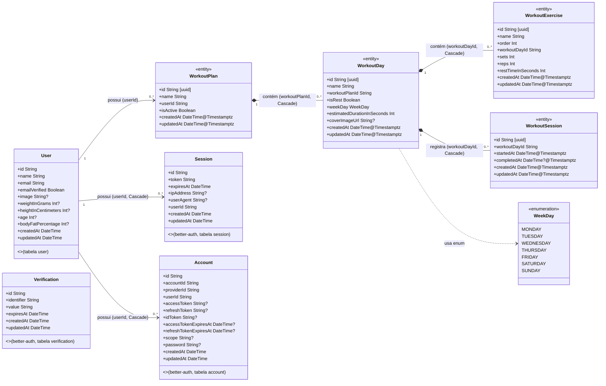
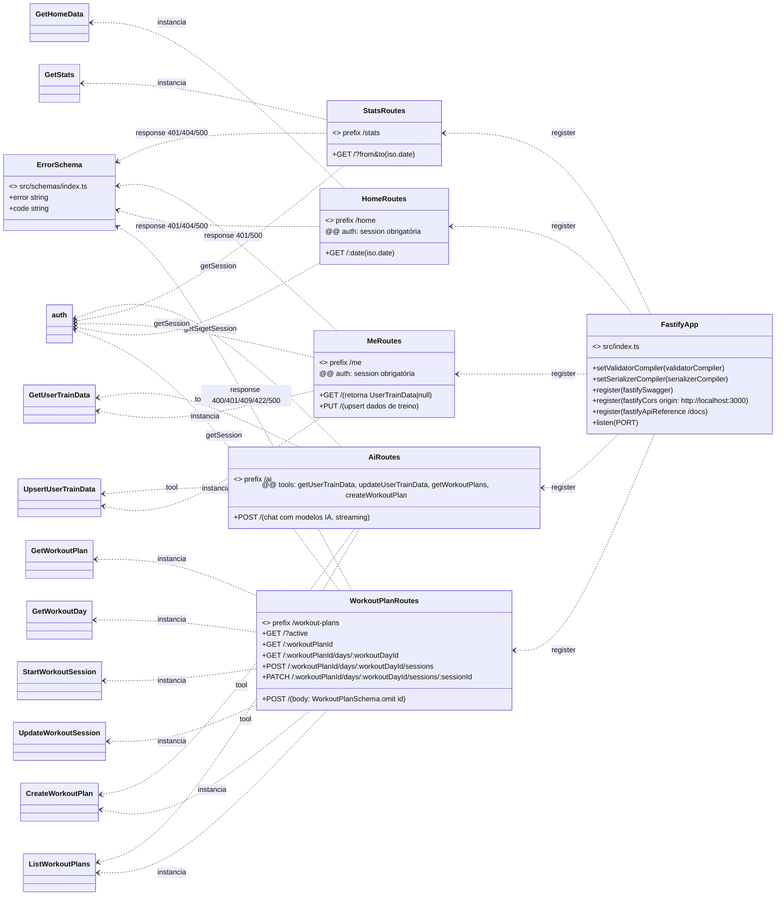
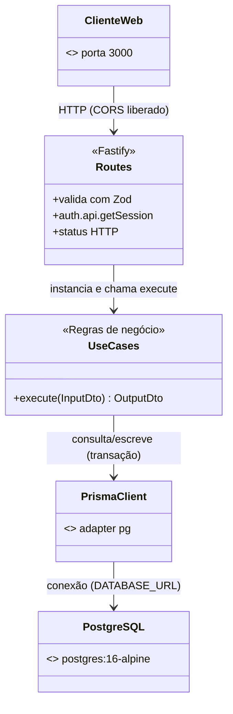

# Diagrama de Classes — Bootcamp Treinos API

> **Projeto analisado:** snapshot `bootcamp-treinos-aula-03` (o mais completo: possui `env.ts`, migrations, `Dockerfile` e integração com IA). As aulas 00/01 trazem as mesmas entidades, com diferenças apontadas ao longo do documento.
>
> **Origem (aulas em vídeo):** estas classes correspondem exatamente ao que a **Aula 2 "Construindo back-end com Node.js"** constrói — o vídeo mostra a criação dos use cases (ex.: `create-workout-plan.ts` renomeado para `CreateWorkoutPlan.ts` conforme a regra PascalCase), o `schema.prisma` e as rotas. A **Aula 3** adiciona o front (web app), esboçado na seção 6.
>
> **Arquitetura do projeto (padrão em camadas):** `Routes → Use Cases → Prisma → PostgreSQL`
>
> - **Routes** — registram a rota no Fastify, validam com Zod, autenticam via `auth.api.getSession()` e mapeiam erros para status HTTP.
> - **Use Cases** — classes com regra de negócio e método único `execute(dto: InputDto): Promise<OutputDto>`. Nunca lançam erro direto em resposta: lançam exceções customizadas.
> - **Schemas (Zod)** — validação compartilhada entre rotas e documentação OpenAPI.
> - **Infra** — `prismaClient` (banco), `auth` (better-auth), `env` (validação de variáveis).

---

## 1. Entidades do domínio (modelos Prisma)

Diagrama das classes de domínio e suas relações, conforme `prisma/schema.prisma`:



**Observações:**
- O `generator` do Prisma usa o provider novo `prisma-client`, com o client gerado em `src/generated/prisma` (gitignored — não commitar).
- `bodyFatPercentage` é um inteiro onde **100 = 100%** (convenção documentada no schema).
- `WorkoutSession.startedAt` marca o início; `completedAt` (nullable) marca a conclusão da sessão.

---

## 2. Camada de aplicação — Use Cases e erros

Os 10 use cases são classes com um único método `execute(dto: InputDto): Promise<OutputDto>`, localizadas em `src/usecases/`. Na Aula 2, o professor explica a escolha por **use case** (uma classe por comportamento, aderente ao *Single Responsibility* e a uma "screaming architecture") em vez de *services* genéricos, e cita a base da **arquitetura hexagonal** (ports & adapters, injeção de dependência/repository) como evolução natural dessa estrutura:

```mermaid
classDiagram
    direction RL

    class CreateWorkoutPlan {
        <<usecase>> src/usecases/CreateWorkoutPlan.ts
        -existingWorkoutPlan: WorkoutPlan?
        +execute(InputDto) OutputDto
        @@ $transaction: desativa plano ativo e cria novo plano
    }

    class ListWorkoutPlans {
        <<usecase>> src/usecases/ListWorkoutPlans.ts
        +execute({userId, active?}) OutputDto[]
        @@ retorna planos do usuário (orderBy createdAt desc)
    }

    class GetWorkoutPlan {
        <<usecase>> src/usecases/GetWorkoutPlan.ts
        +execute({userId, workoutPlanId}) OutputDto
        @@ valida dono do plano (NotFoundError)
    }

    class GetWorkoutDay {
        <<usecase>> src/usecases/GetWorkoutDay.ts
        +execute({userId, workoutPlanId, workoutDayId}) OutputDto
        @@ inclui exercícios e sessões do dia
    }

    class StartWorkoutSession {
        <<usecase>> src/usecases/StartWorkoutSession.ts
        +execute({userId, workoutPlanId, workoutDayId}) OutputDto
        @@ valida plano ativo e sessão única por dia
    }

    class UpdateWorkoutSession {
        <<usecase>> src/usecases/UpdateWorkoutSession.ts
        +execute({userId, workoutPlanId, workoutDayId, sessionId, completedAt}) OutputDto
        @@ atualiza completedAt da sessão
    }

    class GetHomeData {
        <<usecase>> src/usecases/GetHomeData.ts
        -calculateStreak(planId, days, date) Int
        +execute({userId, date}) OutputDto
        @@ hoje, streak e consistência semanal
    }

    class GetStats {
        <<usecase>> src/usecases/GetStats.ts
        -calculateStreak(planId, days, date) Int
        +execute({userId, from, to}) OutputDto
        @@ estatísticas em intervalo de datas
    }

    class GetUserTrainData {
        <<usecase>> src/usecases/GetUserTrainData.ts
        +execute({userId}) OutputDto | null
        @@ retorna null se dados incompletos
    }

    class UpsertUserTrainData {
        <<usecase>> src/usecases/UpsertUserTrainData.ts
        +execute({userId, weightInGrams, heightInCentimeters, age, bodyFatPercentage}) OutputDto
        @@ atualiza dados físicos do usuário
    }

    class NotFoundError {
        <<error>>
        +name: "NotFoundError"
    }

    class WorkoutPlanNotActiveError {
        <<error>>
        +name: "WorkoutPlanNotActiveError"
    }

    class SessionAlreadyStartedError {
        <<error>>
        +name: "SessionAlreadyStartedError"
    }

    class PrismaClient {
        <<infra>> src/lib/db.ts (singleton)
        +adapter PrismaPg
        +user
        +workoutPlan
        +workoutDay
        +workoutExercise
        +workoutSession
        +$transaction(fn)
    }

    class betterAuth {
        <<infra>> src/lib/auth.ts
        +api.getSession(headers) Session
        +handler(req) Response
    }

    class env {
        <<infra>> src/lib/env.ts (Zod)
        +PORT number
        +DATABASE_URL string
        +BETTER_AUTH_SECRET string
        +API_BASE_URL string
        +GOOGLE_CLIENT_ID string
        +GOOGLE_CLIENT_SECRET string
        +GOOGLE_GENERATIVE_AI_API_KEY string
        +OPENAI_API_KEY string?
        +WEB_APP_BASE_URL string
        +NODE_ENV enum
    }

    CreateWorkoutPlan ..> PrismaClient : consulta/escreve
    ListWorkoutPlans ..> PrismaClient : consulta
    GetWorkoutPlan ..> PrismaClient : consulta
    GetWorkoutDay ..> PrismaClient : consulta
    StartWorkoutSession ..> PrismaClient : escreve session
    UpdateWorkoutSession ..> PrismaClient : atualiza session
    GetHomeData ..> PrismaClient : consulta (dayjs/utc)
    GetStats ..> PrismaClient : consulta (dayjs/utc)
    GetUserTrainData ..> PrismaClient : consulta user
    UpsertUserTrainData ..> PrismaClient : atualiza user

    StartWorkoutSession ..> NotFoundError : lança
    StartWorkoutSession ..> WorkoutPlanNotActiveError : lança
    StartWorkoutSession ..> SessionAlreadyStartedError : lança
    CreateWorkoutPlan ..> NotFoundError : lança
    GetWorkoutPlan ..> NotFoundError : lança
    GetWorkoutDay ..> NotFoundError : lança
    UpdateWorkoutSession ..> NotFoundError : lança
    GetStats ..> NotFoundError : lança
```

**Error → HTTP (**mapeado nas rotas**):**

| Erro | Status |
| --- | --- |
| `NotFoundError` | 404 `NOT_FOUND_ERROR` |
| `WorkoutPlanNotActiveError` | 422 `WORKOUT_PLAN_NOT_ACTIVE_ERROR` |
| `SessionAlreadyStartedError` | 409 `SESSION_ALREADY_STARTED_ERROR` |
| Não autenticado (`getSession` nulo) | 401 `UNAUTHORIZED` |
| Qualquer outro | 500 `INTERNAL_SERVER_ERROR` |

---

## 3. DTOs por use case (interfaces InputDto / OutputDto)

Cada use case define seus DTOs no próprio arquivo. Resumo dos campos:

| Use case | InputDto | OutputDto |
| --- | --- | --- |
| `CreateWorkoutPlan` | `userId`, `name`, `workoutDays[]` (name, weekDay, isRest, estimatedDurationInSeconds, coverImageUrl?, exercises[]) | `id`, `name`, `workoutDays[]` (com exercises[]) |
| `ListWorkoutPlans` | `userId`, `active?` | `[{ id, name, isActive, workoutDays[] (com exercises[]) }]` |
| `GetWorkoutPlan` | `userId`, `workoutPlanId` | `id`, `name`, `workoutDays[]` (com `exercisesCount`) |
| `GetWorkoutDay` | `userId`, `workoutPlanId`, `workoutDayId` | `id`, `name`, `isRest`, `coverImageUrl?`, `estimatedDurationInSeconds`, `weekDay`, `exercises[]`, `sessions[]` |
| `StartWorkoutSession` | `userId`, `workoutPlanId`, `workoutDayId` | `userWorkoutSessionId` |
| `UpdateWorkoutSession` | `userId`, `workoutPlanId`, `workoutDayId`, `sessionId`, `completedAt` | `id`, `startedAt`, `completedAt` |
| `GetHomeData` | `userId`, `date` | `activeWorkoutPlanId?`, `todayWorkoutDay?`, `workoutStreak`, `consistencyByDay` |
| `GetStats` | `userId`, `from`, `to` | `workoutStreak`, `consistencyByDay`, `completedWorkoutsCount`, `conclusionRate`, `totalTimeInSeconds` |
| `GetUserTrainData` | `userId` | `userId`, `userName`, `weightInGrams`, `heightInCentimeters`, `age`, `bodyFatPercentage` (ou `null`) |
| `UpsertUserTrainData` | `userId`, `weightInGrams`, `heightInCentimeters`, `age`, `bodyFatPercentage` | `userId`, `weightInGrams`, `heightInCentimeters`, `age`, `bodyFatPercentage` |

**Regra de arquitetura (extraída de `.claude/rules/architecture.md`):** o use case nunca retorna o model do Prisma diretamente — sempre mapeia o resultado para o `OutputDto` (desacoplamento entre camada de negócio e banco).

---

## 4. Camada de apresentação — Rotas (Fastify)

As rotas não são classes; são **funções registradas no app** (src/index.ts), mas podem ser vistas como "grupos de endpoints" que usam os use cases:



**Endpoints documentados (par distância):**

| Rota | Método | Autenticação | Use case → status |
| --- | --- | --- | --- |
| `/home/:date` | GET | sim | `GetHomeData` → 200/404/500 |
| `/me` | GET | sim | `GetUserTrainData` → 200 (nullable)/500 |
| `/me` | PUT | sim | `UpsertUserTrainData` → 200/500 |
| `/stats/?from&to` | GET | sim | `GetStats` → 200/404/500 |
| `/workout-plans/?active` | GET | sim | `ListWorkoutPlans` → 200/500 |
| `/workout-plans` | POST | sim | `CreateWorkoutPlan` → 201/404/500 |
| `/workout-plans/:id` | GET | sim | `GetWorkoutPlan` → 200/404/500 |
| `/workout-plans/:id/days/:dayId` | GET | sim | `GetWorkoutDay` → 200/404/500 |
| `/workout-plans/:id/days/:dayId/sessions` | POST | sim | `StartWorkoutSession` → 201/404/409/422/500 |
| `/workout-plans/:id/days/:dayId/sessions/:sessionId` | PATCH | sim | `UpdateWorkoutSession` → 200/404/500 |
| `/ai` | POST | sim | streaming de resposta (tools) → 401/200 |

---

## 5. Visão de camadas (fluxo simplificado)



---

## 6. Camada de apresentação do web app (front-end — Aula 3)

O projeto `bootcamp-treinos-frontend` (Next.js) não está nos snapshots; o esqueleto abaixo foi observado na **Aula 3** (pastas/código mostrados na tela) e é apresentado de forma ilustrativa:

```mermaid
classDiagram
    direction RL

    class NextApp {
        <<Next.js 16 App Router>> app/
        +page.tsx (Home)
        +auth/page.tsx (Login)
        +profile/page.tsx (Perfil + logout)
        +stats (estatísticas/heatmap)
        +workout-plans/[id]/page.tsx
        +workout-plans/[id]/days/[id]/page.tsx
        +workout-plans/[id]/days/[id]/_actions.ts (server actions)
        +layout.tsx + globals.css
    }

    class Components {
        <<React (shadcn/ui)>> app/_components/ + components/ui
        +Button (components/ui/button — regra: sempre usar o do shadcn)
        +BottomNav
        +WorkoutDayCard
        +ConsistencyTracker
        +ExerciseCard / ExerciseItem
        +Chat (chat.tsx)
    }

    class AuthClient {
        <<app/_lib>> app/_lib/auth-client.ts
        +authClient.useSession()
        +authClient.signIn.social({ provider: "google" })
    }

    class FetchGenerated {
        <<gerado por Orval>> app/_lib/api/fetch-generated/index.ts
        +getHomeData()
        +getWorkoutPlan()
        +getWorkoutDay()
        +startWorkoutSession()
        +updateWorkoutSession()
        +getStats()
    }

    class FetchBase {
        <<app/_lib + raiz>> app/_lib/api/fetch.ts + orval.config.ts
        @@ mutator: URL da API + credentials include
    }

    class ChatIA {
        <<Vercel AI SDK>>
        +useChat({ transport: DefaultChatTransport ~NEXT_PUBLIC_API_URL/ai~ })
        +streamdown (renderização das mensagens)
    }

    class UrlState {
        <<nuqs 2.8.8>>
        +chatOpen (true/false)
        +message (pergunta inicial)
    }

    class EnvFront {
        <<.env>>
        +NEXT_PUBLIC_API_URL (http://localhost:8080)
        +URL pública do app (retorno do login)
    }

    NextApp ..> Components : importa
    NextApp ..> FetchGenerated : chama (Orval)
    NextApp ..> AuthClient : autentica (sessão)
    NextApp ..> ChatIA : chat Coach AI (usa /ai, sem Orval)
    NextApp ..> UrlState : estado do chat na URL
    NextApp ..> EnvFront : lê variáveis públicas
    FetchGenerated ..> FetchBase : configurado via orval.config.ts
    FetchGenerated ..|> ApiSwagger : gerado de /swagger.json (operationId)

    class ApiSwagger {
        <<fonte>> API Fastify
        +/swagger.json (OpenAPI)
    }
```

**Fatos observados nas aulas (Aula 3):** telas fiéis ao design no **Figma (FIT.AI)** — as `tasks/*.md` pedem "SEJA 100% FIEL AO FIGMA"; client da API gerado com **Orval 8.1.0** (usa os `operationId` das rotas e o mutator com `credentials: "include"`); autenticação com **authClient do better-auth 1.4.18** (login Google); chat com **Vercel AI SDK** (`useChat`), mensagens com `streamdown` e abertura via **URL state (nuqs)**; "marcar como concluído"/"iniciar treino" usam **server actions** + `revalidatePath`; o professor valida a UI com o **Chrome DevTools MCP**. Sempre que a API muda, o Orval é rodado de novo (`npx orval`).

---

## 7. Diferenças entre os snapshots (relevantes ao diagrama)

| Aspecto | aula-00 / aula-01 | aula-03 |
| --- | --- | --- |
| Validação de ambiente | usa `process.env` diretamente | classe `env.ts` com Zod |
| Logs | `logger: true` (pino padrão) | `pino-pretty` formatado em dev |
| Migrations | não inclui | `prisma/migrations/20260304223538_init` |
| Dockerfile | não inclui | multi-stage (`node:24-slim` + corepack) |
| IA (`/ai`) | rota presente, sem tools | tools via `@ai-sdk/google`/`openai` e `ai` SDK |
| Artefatos de contratos | — | `workout-plan (1).json` como payload de exemplo |

---

## Nota prática ao docente

**Uso em aula:** o diagrama é transversal ao projeto e pode ser explorado nas Aulas 03 (elementos e camadas de um aplicativo móvel — o diagrama do item 5 ilustra bem o padrão em camadas), 09/10 (persistência — entidades do item 1) e 12 (consumo de APIs — endpoints do item 4).

**Como trabalhar:** peça que os estudantes preencham/criem um mini diagrama a partir de um novo endpoint (ex.: `DELETE /workout-plans/:id`), aplicando o mesmo padrão customizam `Route → Use Case → Prisma → OutputDto`. O exercício de "ler o diagrama e explicar o fluxo em 2 minutos" é boa checagem de compreensão.

**Possíveis dificuldades:** os DTOs duplicam as estruturas das entidades — alunos podem estranhar a "redundância"; explique que o `OutputDto` é o contrato público da API (desacoplamento recomendado nas regras do projeto). O uso de Zod `z.interface()`/`z.url()`/`z.iso.*` nas respostas deve ser destacado para evitar o uso de regex manuais.

**Ajustes para turmas heterogêneas:** iniciantes usam os itens 1 e 5 apenas (entidades e fluxo); intermediário: item 2 (use cases + erros); avançado: reproduzir o diagrama de rotas do item 4 com `curl`/`docs` (interface Scalar) comparando os status codes da tabela.
