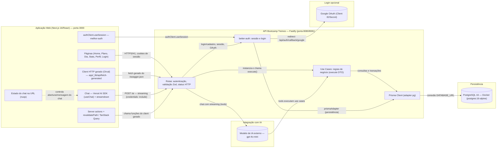
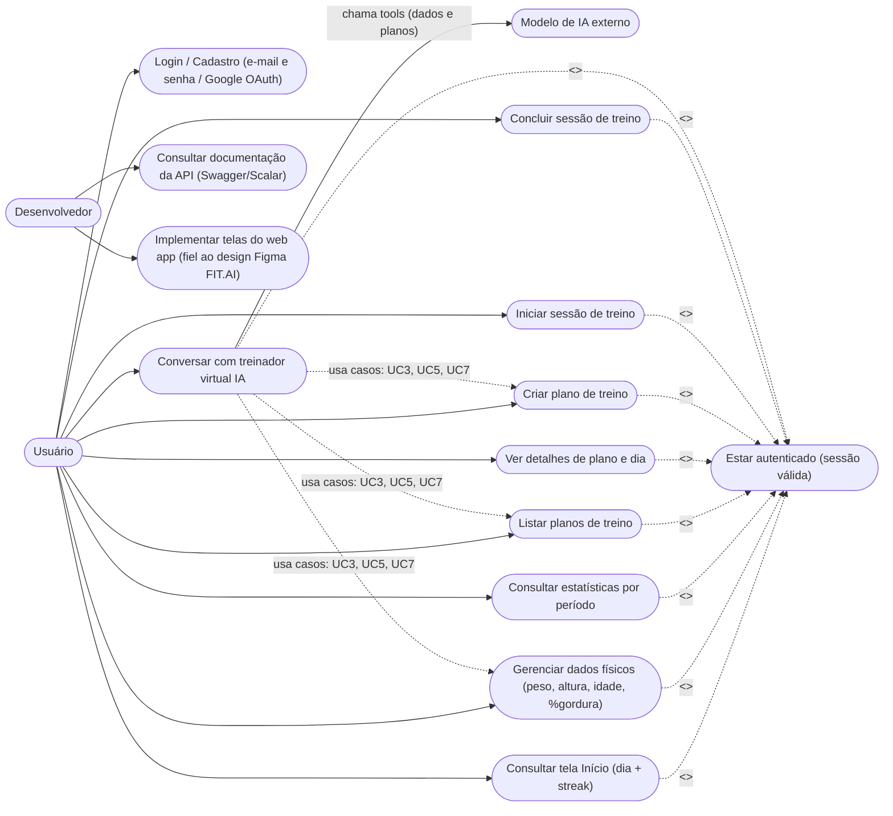
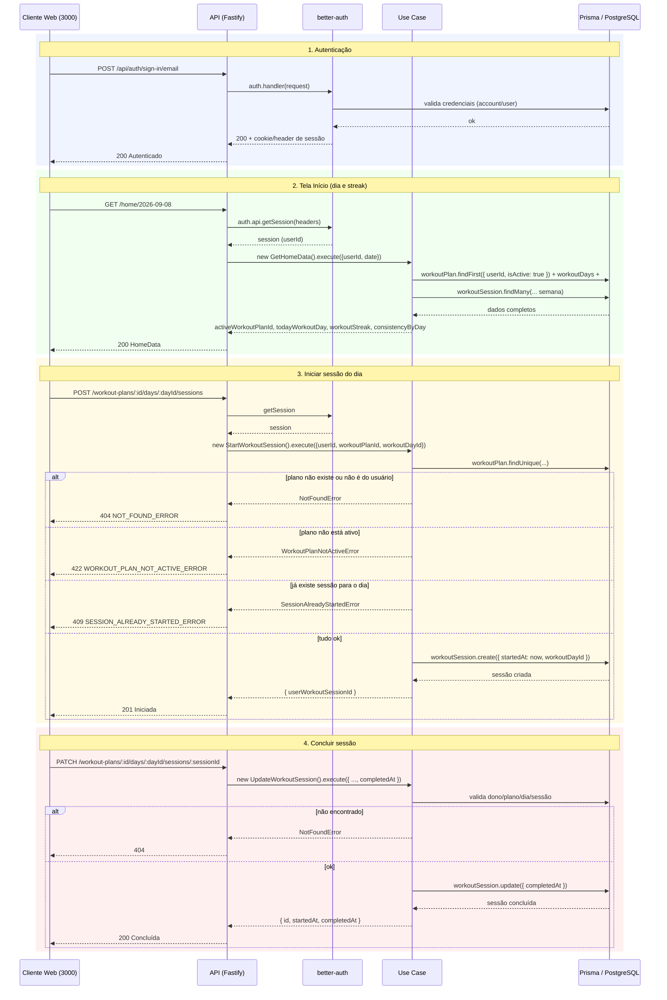
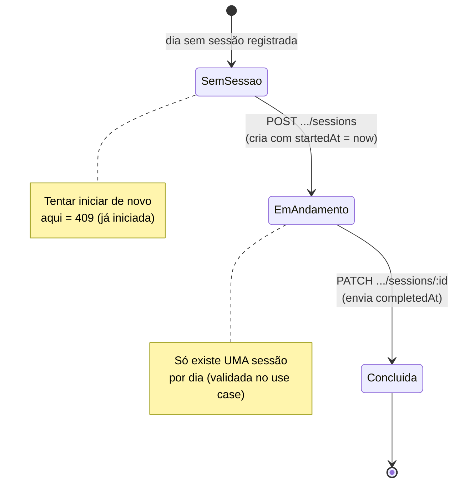
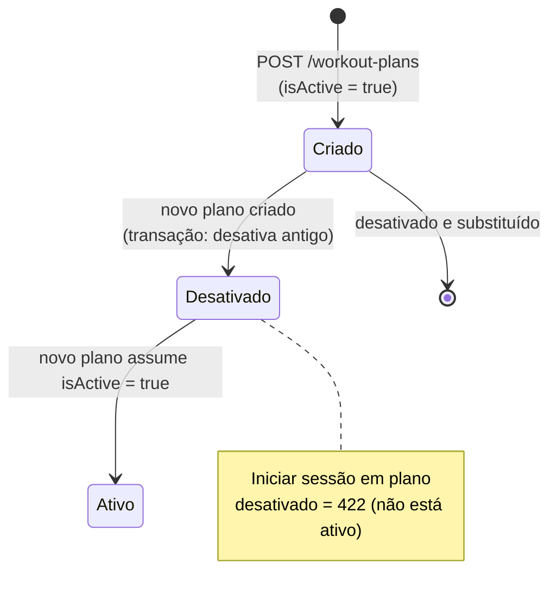
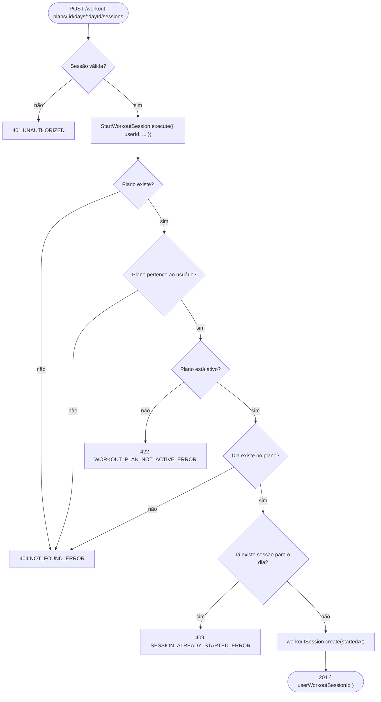

# Diagrama UML do Sistema — Bootcamp Treinos (FIT.AI)

> **Objetivo:** descrever, de forma generalizada, **como o sistema funciona** — componentes, atores, casos de uso, fluxos de interação, estados e atividades.
> **Base:** código do snapshot `bootcamp-treinos-aula-03` (rotas Fastify, use cases, Prisma 7/PostgreSQL 16, better-auth, integração com IA), `docker-compose.yml` e as aulas em vídeo: **Aula 2** (back-end, exatamente este código) e **Aula 3** (web app em Next.js que consome a API — incluído aqui como "Aplicação Web").

---

## 1. Visão de contexto (componentes principais)

- **Dois projetos**: `bootcamp-treinos-frontend` (**Next.js 16**/React + TypeScript: páginas, Tailwind + shadcn/ui, Orval para o client HTTP, TanStack Query/server actions para as ações e AI SDK para o chat) e `bootcamp-treinos-api` (Fastify). O front é "mobile-first" (apresentação FIT.AI) e foi desenhado no **Figma** — as telas do web app são construídas "fiéis ao FIGMA" (specs em `tasks/*.md`).
- O `better-auth` usa o mesmo banco no modo "adapter" (Prisma), com modelos `Session`, `Account` e `Verification` próprios; o login por Google é via **OAuth 2.0** configurado no Google Cloud Console (callback `http://localhost:8080/api/auth/callback/google`, com `prompt: "select_account"` no provedor). No código fornecido (aula-03) o login por **e-mail/senha** está habilitado; na Aula 3 ele é substituído pelo Google.
- **Orval** gera o cliente HTTP tipado a partir do `swagger.json` (usando os `operationId` das rotas) — o front quase nunca escreve fetch manualmente (a exceção é o chat `/ai`, via AI SDK). Sempre que a API muda, o client é regenerado (`npx orval`).
- **Validação de UI por IA (Aula 3):** o professor conecta o **Chrome DevTools MCP** para o agente abrir a aplicação, tirar screenshots, ler console/CSS e comparar com o Figma durante o desenvolvimento.

---

## 2. Diagrama de casos de uso

**Regra de autenticação:** todos os casos de uso, exceto login e documentação, exigem sessão válida: as rotas chamam `auth.api.getSession()` e respondem **401 `UNAUTHORIZED`** sem sessão. As regras de negócio garantem também que o usuário só opera **seus próprios** dados (casos de "dono" verificam `userId`).

**Desenvolvimento (UC11/UC12):** o desenvolvedor consulta a API em `/docs` e as especificações (`tasks/*.md`, em geral referenciando o **Figma** para as telas) e implementa com apoio de **agentes de IA** (Claude Code) + regras de `.claude/rules/` — processo "Driven Specs" observado nas Aulas 2 e 3. O web app em si é usado pelo Usuário, mas quem o integra com a API é o Desenvolvedor.

**Interação com IA (UC10):** a conversa usa `streamText` com o modelo OpenAI **gpt-4o-mini** e o `SYSTEM_PROMPT` de "personal trainer". O modelo chama **tools** registradas (`getUserTrainData`, `updateUserTrainData`, `getWorkoutPlans`, `createWorkoutPlan`) que delegam aos use cases — por isso UC10 está associado a UC3/UC5/UC7. Como a rota `/ai` também só responde com sessão, o ator "Modelo de IA" **não executa nada diretamente**: é a API que elege a ferramenta do usuário autenticado.

---

## 3. Diagrama de sequência — fluxo de um dia de treino

---

## 4. Diagrama de estados

### Sessão de treino (`WorkoutSession`)

### Plano de treino (`WorkoutPlan`) — um ativo por vez

**Comportamento garantido pelo use case `CreateWorkoutPlan`:** antes de criar o novo plano, a transação do Prisma desativa (`isActive = false`) o plano ativo anterior — a regra "**um plano ativo por vez**" é de aplicação, não de banco.

---

## 5. Diagrama de atividade — iniciar sessão de treino

Fluxo com passos de validação e pontos de decisão (implementados em `StartWorkoutSession` + rota):

---

## 6. Resumo comportamental do sistema

| Contexto | Comportamento |
| --- | --- |
| Autenticação | e-mail/senha habilitado no código (better-auth, sessão por cookie) + OAuth Google na Aula 3 (`socialProviders`, `prompt: "select_account"`); o web app lê a sessão com `authClient.useSession()` e a página de perfil faz logout |
| Autorização | toda rota de dados verifica a sessão; use cases conferem o `userId` do dono |
| Transação | criação de plano: desativa o anterior e cria o novo em uma única transação |
| Exclusão | tudo em **Cascade**: apagar usuário remove planos, dias, exercícios, sessões e tabelas do better-auth |
| IA | chat em streaming (limite por `stepCountIs`); o modelo decide quais tools chamar |
| Ações do front | iniciar/concluir treino via **server actions** + `revalidatePath`; chat aberto por **URL state** (nuqs); client HTTP tipado pelo **Orval** a partir do `/swagger.json` |
| Documentação | OpenAPI em `/swagger.json`; UI interativa em `/docs` (Scalar) |

---

## Nota prática ao docente

**Uso em aula:** este material serve como "mapa do funcionamento" — bom para abrir a Aula 11 (construção de API REST: sequência e atividade) e revisar antes da N2 (Projeto Final), pois demonstra o padrão **requisição → autenticação → regra de negócio → banco → resposta** que os estudantes vão replicar. Os vídeos ajudam a contextualizar: a Aula 2 constrói a API (mesmo código), e a Aula 3 adiciona o web app Next.js que consome a API (com Orval + AI SDK), ilustrando o sistema completo.

**Atividade sugerida:** cada dupla escolhe um endpoint (ex.: `PUT /me`) e reproduz, em Mermaid, os itens 3 e 5 adaptados; comparar desenhos entre os pares gera discussão sobre consistência de erros/status codes.

**Possíveis dificuldades:** a noção de "um plano ativo por vez" e "uma sessão por dia" serem regras **de aplicação** (não constraints de banco) é o ponto abstrato mais delicado — vale reforçar com os diagramas de estado e atividade. A integração com IA (tools) também costuma gerar dúvidas: esclareça que a IA só age dentro de tools assíncronas autenticadas, nunca acessa o banco diretamente.

**Turmas heterogêneas:** iniciantes focam nos itens 1 e 2 (o que o sistema faz); intermediários no item 3 (como); avançados modelam o estado do plano/sessão com um terceiro diagrama (ex.: transições possíveis de `completedAt` com datas) justificando decisões de LHC/UX.
